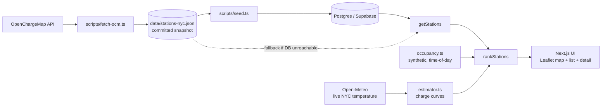

# WattFinder

**[Live demo](https://wattfinder-dun.vercel.app)**

**An EV charging companion for NYC that ranks nearby stations by total time (drive + wait + an honest charge time for your specific car), instead of by the max kW printed on the sticker.**

Live demo: not deployed yet. See [Roadmap](#roadmap).

## The problem

Charging apps tell you a station delivers "150 kW" and leave the math to you. Two things go wrong:

1. **The sticker number is not what your car gets.** Charging slows as the battery fills, and every car accepts power differently. A Chevy Bolt on a 150 kW charger pulls roughly 42 kW on average from 10 to 80%. Naive `kWh / kW` says 18 minutes. The curve says 65.
2. **You don't know if the station is free.** A trip to an occupied charger can cost more than the charge itself.

WattFinder answers both with one recommendation: "Station B, 4 min away, short wait, about 22 min to 80%."

## What it does

1. Pick your car (Tesla Model 3 LR RWD, Hyundai Ioniq 5 LR AWD, or Chevy Bolt EV).
2. Set your current and target battery level with sliders.
3. See NYC stations on a Leaflet map and in a ranked list. Each is scored by estimated drive time + modeled wait + charge time.
4. Open a station to see your car's charge curve against that station's power limit, plus the naive estimate next to the honest one.

## How the estimate works

Each car has a charge curve: the power it accepts (kW) at each state of charge (SoC, %). Between published anchor points the app interpolates linearly. At any SoC the power actually delivered is the slower of the two sides:

```
P(s) = min( car_accepted_kW(s), station_kW )
```

Time to charge from `s0` to `s1` is the energy in each slice divided by the power in that slice, summed over the range. The estimator uses 0.5% slices:

```
minutes = sum over slices of  ( usable_kWh * 0.005 / P(s_mid) ) * 60
```

A cold battery charges slower, so the app multiplies the car's accepted power by a derating factor driven by live NYC temperature (see below).

### Worked example (10% to 80%, from `src/lib/estimator.test.ts` and the estimator itself)

| Car | Station | Naive `kWh / kW` | Curve-based | Average power actually delivered |
|---|---|---|---|---|
| Tesla Model 3 LR RWD (78 kWh) | 250 kW | 13 min | **32 min** | 104 kW |
| Hyundai Ioniq 5 LR AWD (80 kWh) | 350 kW | 10 min | **18 min** | 189 kW |
| Chevy Bolt EV (65 kWh) | 150 kW | 18 min | **65 min** | 42 kW |

The Ioniq 5 shows the station mattering: on a 150 kW unit the same 10 to 80% takes 24 minutes instead of 18. The Bolt shows the opposite: it peaks near 55 kW, so a 350 kW charger and a 50 kW charger give nearly the same result (65 vs 67 min). Spending extra to find a fast charger is wasted on that car, and the app says so.

Estimates are checked against published test times (Model 3 target about 34.5 min, Ioniq 5 about 19.5 min, Bolt about 73 min). The Bolt reads low because linear interpolation smooths its hard power steps. That is a known gap, noted in the code.

## Architecture



- `getStations()` reads Postgres and falls back to the committed OpenChargeMap snapshot (1,656 stations, 1,790 connectors, fetched in tiles so the API's 500-result cap cannot drop any) if the database is unreachable. The app works with no database at all.
- `occupancy.ts` produces deterministic, time-of-day-aware availability in NYC local time, seeded by station id.
- `weather.ts` fetches live temperature from Open-Meteo and feeds the estimator's cold-pack derating.
- `recommend.ts` ranks stations by drive time + modeled wait + charge time.

## Data sources and honesty

| Data | Status | Notes |
|---|---|---|
| Station locations, connector types, kW ratings | **Real** | OpenChargeMap snapshot, fetched once |
| Charge curves | **Real, published** | Digitized from EVKX, EV-Database, InsideEVs tests, assuming a warm pack |
| NYC temperature | **Live** | Open-Meteo, no key. This is the one real-time input |
| Station availability / wait | **Modeled** | Synthetic, deterministic, time-of-day aware. Not live occupancy |
| Drive time | **Estimated** | Straight-line distance x 1.3 road factor at an assumed 18 km/h city average, plus 12 min when the trip crosses the Hudson. Not routed |

Why availability is modeled: OpenChargeMap is a registry of where chargers are, not a feed of whether they are in use. Real occupancy needs a network or a paid source (see roadmap). I would rather ship a clearly labeled model than imply live data I don't have. The UI marks availability as modeled.

## Getting started

**Prerequisites:** Node 20+ and npm.

1. Clone the repo and enter it:
   ```bash
   git clone https://github.com/Rezwan3App/wattfinder.git
   cd wattfinder
   ```
2. Install dependencies:
   ```bash
   npm install
   ```
3. Copy the env template:
   ```bash
   cp .env.local.example .env.local
   ```
4. Run the app:
   ```bash
   npm run dev
   ```
   Open http://localhost:3000. **This works with no keys at all.** With `DATABASE_URL` unset or unreachable, the app reads the committed snapshot in `data/stations-nyc.json`. Weather needs no key either.
5. Run the estimator checks:
   ```bash
   npm run test:estimator
   npm run test:recommend
   ```

### Optional: refresh the data and use Postgres

| Variable | Needed for | Required to run the app? |
|---|---|---|
| `OPENCHARGEMAP_API_KEY` | `npm run fetch:stations` (free key from openchargemap.org: My Profile, My Apps) | No |
| `DATABASE_URL` | `npm run seed` and DB-backed reads | No (snapshot fallback) |
| `NEXT_PUBLIC_SUPABASE_URL`, `NEXT_PUBLIC_SUPABASE_ANON_KEY`, `SUPABASE_SERVICE_ROLE_KEY` | Reserved for future Supabase client use. The app and seed script only use `DATABASE_URL` today | No |

```bash
npm run fetch:stations   # OpenChargeMap -> data/stations-nyc.json
npm run seed             # snapshot -> Postgres (truncates and reloads)
```

The schema is in `db/schema.sql`; apply it to a fresh Postgres before seeding.

**Supabase connection notes:**

- Use the **pooler** connection string for `DATABASE_URL`: Supabase dashboard, Connect, Session pooler. The direct host `db.<ref>.supabase.co` is IPv6-only, so it fails on IPv4 networks and on Vercel.
- Free-tier projects pause after about a week idle. If the DB is unreachable, restore the project from the Supabase dashboard. The app keeps working from the snapshot in the meantime.

## Project structure

```
src/lib/estimator.ts       charge curves, min(car, station) integration, cold derating
src/lib/estimator.test.ts  self-check against published charge times
src/lib/stations.ts        getStations(): Postgres with snapshot fallback
src/lib/occupancy.ts       synthetic time-of-day availability model
src/lib/weather.ts         live NYC temperature (Open-Meteo)
src/lib/recommend.ts       rankStations: drive + wait + charge time
src/app/                   Next.js App Router UI (map, car picker, list, detail)
scripts/fetch-ocm.ts       pulls NYC stations from OpenChargeMap
scripts/seed.ts            loads the snapshot into Postgres
db/schema.sql              Postgres schema (stations, station_connections)
data/stations-nyc.json     committed station snapshot
docs/overview.html         one-page visual overview
```

## Roadmap

- [x] Data layer: 1,656 NYC stations and 1,790 connectors (tiled OpenChargeMap fetch), Postgres with snapshot fallback
- [x] Charge-time estimator with per-car curves, validated against published times
- [x] Occupancy model, live weather, and ranking (`src/lib`)
- [x] Map UI: Leaflet map, car picker, sliders, ranked list, detail view
- [ ] Mobile-first polish pass and Vercel deploy
- [ ] Walkthrough video and portfolio write-up
- [ ] Bolt step-function curve (replaces linear interpolation)
- [ ] **True live availability.** Realistic sources: Google Places API (New) `evChargeOptions` availability counts (paid, requires Google Cloud billing), or the NREL AFDC station API (free key, but it reports station status, not occupancy). Either would replace the synthetic model.

## Attribution

- Charging station data: [OpenChargeMap](https://openchargemap.org), CC BY-SA 4.0
- Map tiles: OpenStreetMap contributors
- Weather: [Open-Meteo](https://open-meteo.com), CC BY 4.0
- Charge curves: EVKX, EV-Database, and InsideEVs charging tests (anchor points are my own digitization)

## Project narrative

Charging apps have two blind spots. They rarely know whether a nearby station is free right now, and they estimate charge time with a calculation that ignores how batteries behave. Drivers get a "150 kW" label and are left to guess, which is how a 25-minute stop becomes an hour.

I built WattFinder to close that gap for three deliberately different EVs, each of which tapers, plateaus, or steps down differently as the battery fills. The estimator takes the minimum of what the car accepts and what the station delivers at each state of charge, so the app can say how it got to its number.

It is also where my two backgrounds meet: mechanical engineering training in battery behavior and power delivery, and a product instinct for turning that into one trustworthy decision. The honesty angle, showing the real number instead of the sticker spec, is both the technical differentiator and the product call.

A portfolio project, built to be shown, not sold.
